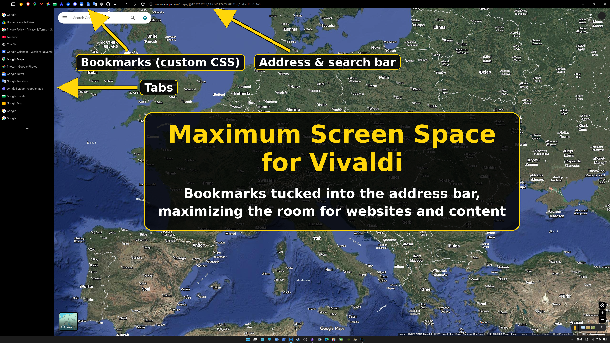

# Vivaldi Single-Bar Bookmarks

A small custom CSS mod for the [Vivaldi browser](https://vivaldi.com) that moves your bookmarks **into the address bar row** as tiny, icon-only buttons. No separate bookmark bar, no wasted vertical space, no extensions and no JavaScript.

## What you get

- **One thin bar** instead of two: bookmarks, address/search field, and window controls all share a single row.
- **Icon-only bookmarks** with a background that appears only on hover, so the bar stays clean.
- **Overflow menu**: bookmarks that don't fit in the strip go into Vivaldi's native `»` dropdown (visible in the screenshot).
- **Responsive**: in narrow windows the strip collapses so only the `»` button remains.
- **Easy to tweak**: all sizes and positions are CSS variables at the top of the file.

## Requirements

- Vivaldi (Windows, macOS, or Linux)
- Bookmark bar enabled and set to the **top**
- Works best with tabs on the **side** (as in the screenshot) and the address bar at the top, so the row is as thin as possible

## Installation

1. **Show the bookmark bar at the top.**
   `Settings → Bookmarks → Bookmark Bar` and enable it with position **Top**.
2. **Download `custom.css`** from this repository and put it in a folder of your choice (for example `Documents/vivaldi-mods`).
3. **Allow CSS modifications.**
   Open `vivaldi://experiments` and enable **Allow for using CSS modifications** if it's listed (it may not be in newer versions), then restart Vivaldi.
4. **Point Vivaldi at the folder.**
   `Settings → Appearance → Custom UI Modifications` and choose the folder containing `custom.css`.
5. **Restart Vivaldi.** Your bookmarks should now sit in the top-left of the address bar row.

> **Tip:** Vivaldi only loads modifications at startup, so restart the browser (or use `vivaldi://restart`) after every edit to `custom.css`.

## Customization

Edit the variables at the top of `custom.css`:

| Variable | Default | What it does |
|---|---|---|
| `--bm-bar-width` | `450px` | Width of the bookmark strip. Anything that doesn't fit goes into the `»` menu. |
| `--bm-bar-left` | `72px` | Distance from the left edge. Increase it if the strip overlaps the menu and panel buttons. |
| `--bm-bar-top` | `1px` | Distance from the top edge. |
| `--bm-bar-height` | `20px` | Height of the strip. |
| `--bm-btn-size` | `26px` | Width and height of each bookmark button. |
| `--bm-btn-margin-top` | `3px` | Vertical nudge for the buttons. |
| `--bm-btn-hover` | `#333` | Hover background. Match it to your theme. |
| `--pill-*` | | Position, size, and color of the optional decorative pill. Set `--pill-width: 0px` to hide it. |

The default values were tuned on a 1080p laptop display with Vivaldi's thin, single-row layout. On other screens or themes you'll probably want to adjust `--bm-bar-left` and `--bm-bar-width` first.

## Troubleshooting

**Nothing changed.**
Check that the Custom UI Modifications folder is set, that the file is named exactly `custom.css`, and that you fully restarted Vivaldi.

**Bookmarks aren't in the address bar row.**
The bookmark bar needs to be enabled with position **Top**. The CSS targets `#browser.bookmark-bar-top`, so it does nothing if the bar is at the bottom or hidden.

**Bookmarks overlap the menu or panel buttons.**
Increase `--bm-bar-left`.

**Bookmarks overlap the address field or window controls.**
Decrease `--bm-bar-width`.

**It broke after a Vivaldi update.**
Vivaldi's interface is built with HTML and CSS, and the class names it uses can change between versions. If the mod stops working, please [open an issue](../../issues) with your Vivaldi version.

## Uninstalling

Clear the folder under `Settings → Appearance → Custom UI Modifications` (or delete `custom.css`) and restart Vivaldi.

## Notes

- This is a **Vivaldi-only** mod. Chrome and other Chromium browsers don't allow custom CSS in their own interface, and extensions can't change it either.
- The mod only changes how things look. It doesn't read or modify your bookmarks, and it makes no network requests.

## Contributing

Screenshots of your setup, fixes for newer Vivaldi versions, and alternative layouts are all welcome. Open an issue or a pull request.

## License

MIT. Use it, change it, share it.
